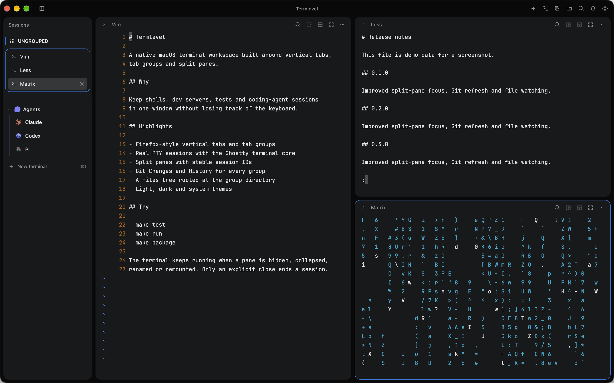

# Termlevel

**A native macOS terminal workspace built around vertical tabs, tab groups and split panes.**

Termlevel keeps shells, development servers, test runs and coding-agent sessions in one window. Firefox-inspired vertical tabs make a long session list readable; groups keep related work together; split panes let you watch several terminals at once without losing track of where the keyboard goes.

Every session is a real PTY. Rust owns the process and the terminal state, using the official Ghostty 1.0.1 terminal core through a small, memory-safe wrapper. The interface is TSX on NSH's native AppKit backend — no WebView and no browser engine.



[Browse all screenshots](docs/screenshots.md)

## Highlights

### Organize sessions, not windows

- Vertical tabs inspired by Firefox, with a resizable and collapsible sidebar.
- Create, close, rename, pin, reorder and find terminals. Pinned terminals stay at the top of their group or in Ungrouped.
- Tab groups with nine colors, a Firefox-style inline group editor and per-group working directories.
- Drag tabs to reorder them, move them between groups, or turn one into a new group.
- Collapse a group without stopping anything in it. The terminal keeps running and keeps its session ID.
- The whole workspace — groups, tab order, pinned state, split layout, selection, sidebar width, font size, scrollback limit, font and appearance — is restored on restart.

### Watch several terminals at once

- Split a terminal to the right or down, or drop an existing session into the layout.
- Move focus by direction, swap sessions between panes, resize panes from the keyboard or with the divider, and zoom one pane temporarily.
- Drag tabs and pane titles to arrange sessions.
- A pane that is collapsed, hidden or remounted keeps its process and output. Only an explicit close, shell exit or application quit ends it.
- When the window is too narrow for the full layout, Termlevel temporarily shows the focused pane and restores the layout when space returns.

### A real terminal

- The terminal stream, parser, grid, scrollback and high-frequency rendering all live in Rust. TSX handles workspace UI and low-frequency session metadata.
- Full PTY sessions with the user's login shell, resize handling, bracketed paste, mouse reporting, focus reporting, alternate screen, truecolor and ANSI palettes.
- Native AppKit input with IME composition, including Chinese text.
- Terminal selection, double-click word selection, triple-click line selection, cross-screen drag selection and a history scrollbar.
- Find in terminal with ⌘F, including Unicode search over scrollback.
- OSC 8 hyperlinks, Kitty inline images, and text clipboard integration through OSC 52.
- Synchronized output (mode 2026) without showing partial frames.
- Bundled JetBrains Mono with programming ligatures and Sarasa Term SC for CJK coverage, so no extra font installation is required.

### Sessions that tell you what they are doing

- Titles and live working directories from OSC 0/2, OSC 7, ConEmu and iTerm2.
- Desktop-style notifications from OSC 9 and OSC 777, plus BEL alerts, collected in an in-app notification history.
- Program status from OSC 7501 (working, blocked, done, error) and real progress from OSC 9;4, shown on the tab.
- Shell prompt state from OSC 133.
- Agent icons for idle Codex, Claude Code, Grok, Pi and OpenCode sessions.
- A configurable working indicator, with a static version when Reduce Motion is enabled.

### Git inside the workspace

- Per-group **Changes** and **History** views. Changes shows the working tree and per-file diffs; History shows commit lanes, commit details, branches, remotes, tags and worktrees.
- Fetch, fast-forward pull, push, checkout, create or delete branches, and create, open, lock or remove worktrees.
- Multi-repository discovery from the group directory and the terminal's live working directory, with an explicit repository picker and per-group persistence.
- Git views use the system `git` CLI (2.20 or newer). Merge, rebase, cherry-pick, stash and conflict resolution are not implemented.

### Browse and edit files

- A per-group **Files** view with a lazily loaded directory tree rooted at the group directory.
- Open and edit UTF-8 text files up to 512 KiB with syntax highlighting, explicit save, and an unsaved-changes prompt before leaving. Preview Markdown, HTML, images, audio and video, or open other files in the default application.
- Git status letters on file rows and relative-to-HEAD change markers in the editor gutter.
- Reveal in Finder, open with the default app, copy path, open a terminal at a location, and move to Trash after confirmation.
- Non-recursive directory watching on macOS for expanded folders, with manual refresh as a fallback.

### Native look and feel

- A unified window bar with the sidebar and terminal as separate rounded panes.
- Fleet-inspired light, dark and system themes, with semantic theme tokens and nine group colors.
- Settings for appearance, terminal font and size, scrollback limit, working indicator and shortcuts.
- Solid surfaces, custom dialogs and a native menu bar. Switching appearance or moving tabs never recreates a terminal.

## Requirements

- macOS 14 or newer.
- Xcode Command Line Tools.
- Rust 1.97 or newer.
- [NSH](https://github.com/longbridge/nsh) **0.6.0**. The bootstrap script installs the pinned version into the project and verifies its SHA-256 checksum.
- Git 2.20 or newer for the Git views. The terminal itself does not need Git.
- Network access for the first build: Cargo dependencies and the checksum-verified prebuilt libghostty-vt archive are downloaded then.

The project targets macOS arm64 and x86_64. Automated acceptance so far is on macOS arm64; Intel, Windows and Linux have not been platform-accepted.

## Run from source

```sh
git clone https://github.com/biuld/termlevel.git
cd termlevel
./scripts/bootstrap
./scripts/nsh run --window-size 1200x780
```

`./scripts/bootstrap` installs NSH 0.6.0 under `.tools/`. If that installation already exists and is intact, `./scripts/nsh run` can be used directly. A global NSH 0.6.0 installation is also accepted.

The first mixed-project build downloads Rust dependencies and the prebuilt Ghostty archive, so it takes longer than later runs. No manual Node or npm installation is required.

For a deterministic UI preview that never starts a shell or touches real workspace storage:

```sh
TERMLEVEL_PREVIEW=1 ./scripts/nsh run --window-size 1200x780
```

## Package

```sh
./scripts/nsh package --target macos
```

The application bundle is written to `.nsh/out` by default; pass `--out` to choose another directory. The bundle uses the icon at `assets/brand/termlevel-icon-v1.png` and is ad-hoc signed by default. Distribution signing, notarization and updates are not configured yet.

## Keyboard shortcuts

| Action | macOS shortcut |
|---|---|
| New terminal | ⌘T |
| Close current terminal | ⌘W |
| Split right / down | ⌘D / ⌘⇧D |
| Focus adjacent pane | ⌘⌥ + arrow key |
| Swap sessions with adjacent pane | ⌘⌥⇧ + arrow key |
| Zoom / restore pane | ⌘⇧Enter |
| New group | ⌘⇧G |
| Find terminal | ⌘K |
| Find in terminal contents | ⌘F |
| Collapse / expand sidebar | ⌘B |
| Next / previous terminal | Ctrl+Tab / Ctrl+Shift+Tab |
| Switch to terminal 1–9 | ⌘1 … ⌘9 |
| Settings | ⌘, |

While an input method is composing text, key events go to the input method first. Windows and Linux shortcut handling is future work.

## Current limits

Termlevel is early software (version 0.1.0) and does not claim complete Neovim or tmux compatibility.

- Session processes do not survive an application restart. Restart restores the workspace structure and opens new shells in the saved directories; it does not restore old processes or output.
- The IME candidate window, complex composition sequences, cross-line selection, complex emoji, and long-running multi-session performance still need manual acceptance on real hardware.
- Mouse reporting, some modifier and function-key combinations, modern keyboard protocols and cursor-shape support are still being completed.
- Terminal pixel-size queries return 0 because the platform exposes point measurements only.
- Git views are read-only for history and diffs, with the explicit operations listed above. Merge, rebase, cherry-pick, stash and conflict resolution are out of scope for now.
- Only macOS has a working native renderer and input backend.
- Preview mode shows deterministic fixture data. It is not evidence of a real shell, Git repository or file system.

## Design references

Termlevel is an independent project. These products informed interaction and visual decisions; no code or interface assets were copied from them.

- [Firefox](https://www.mozilla.org/firefox/) — vertical tabs, tab groups and the inline group editor.
- [Zed](https://zed.dev/) — the separation of repository discovery, activation and selection in the Git views.
- [Muxy](https://muxy.app/) — project-scoped terminal workspaces, split panes and session-oriented navigation.
- [JetBrains IntelliJ IDEA](https://www.jetbrains.com/idea/) — the Changes / History tool-window model and branch / worktree workflows.
- [JetBrains Fleet](https://blog.jetbrains.com/fleet/2024/12/introducing-fleets-new-islands-ui/) — the Islands UI layout and the light / dark palette direction used by the theme.

## Documentation

| Document | Contents |
|---|---|
| [Development guide](docs/development.md) | Setup, directory ownership, tests and validation commands |
| [Architecture](docs/architecture/README.md) | Current ownership, data paths and lifecycle |
| [UI design](docs/design/ui.md) | Layout, typography, color and theme rules |
| [Terminal design](docs/design/terminal.md) | Terminal renderer, input and SurfaceController |
| [OSC and terminal status](docs/design/osc-status.md) | Supported OSC protocols and status semantics |
| [Roadmap](docs/roadmap.md) | Outstanding work |
| [Screenshots](docs/screenshots.md) | Captured workspace, Git, Files, settings and terminal views |
| [Validation](docs/validation/README.md) | Dated evidence from headless, native and manual checks |

## License

Termlevel is licensed under the [Apache License 2.0](LICENSE). The standalone `termlevel-ghostty-vt` and `termlevel-ghostty-vt-sys` wrappers retain their own MIT licenses. Third-party code, fonts and brand assets are documented in their respective directories.
