# Screenshots

These captures come from the real AppKit app. Workspace, Git and Files use deterministic preview or fixture data; status, notifications and the split-pane CLI view use temporary demo files in `/tmp`. No personal workspace, Git repository, shell profile or file is read. See [tests/screenshots](../tests/screenshots/README.md) to regenerate them.

## Workspace

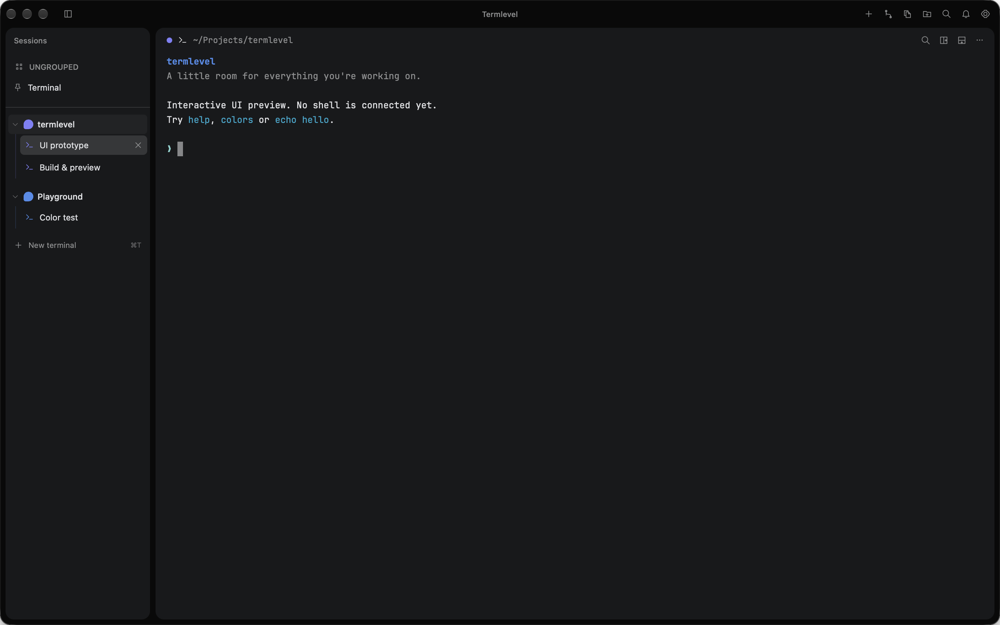

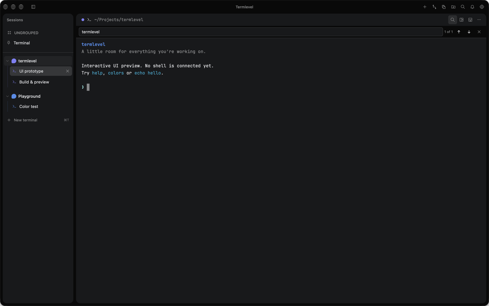

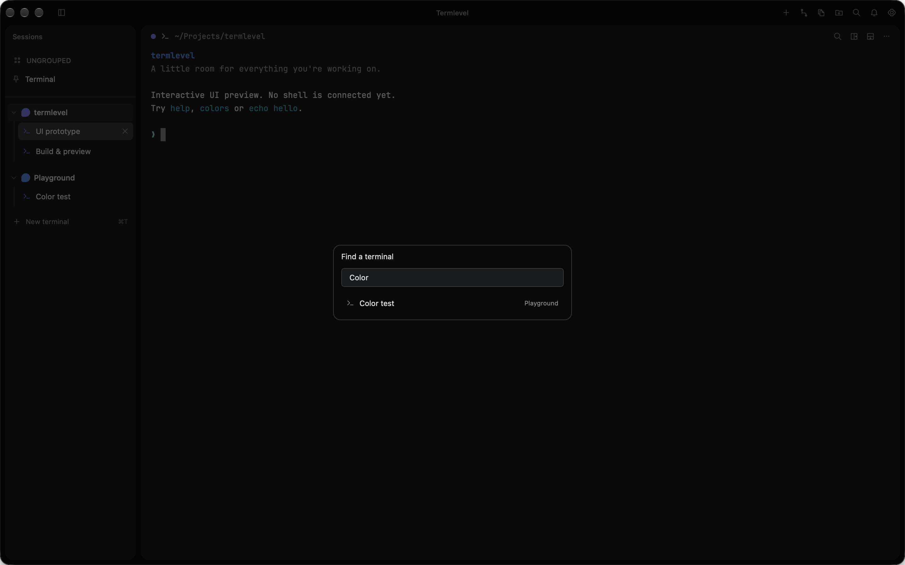

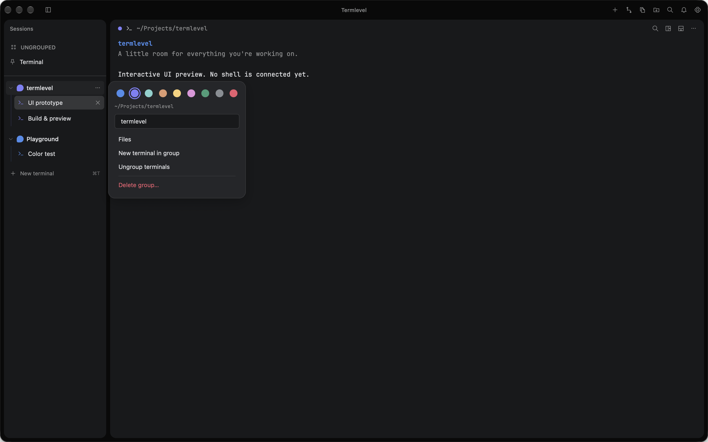

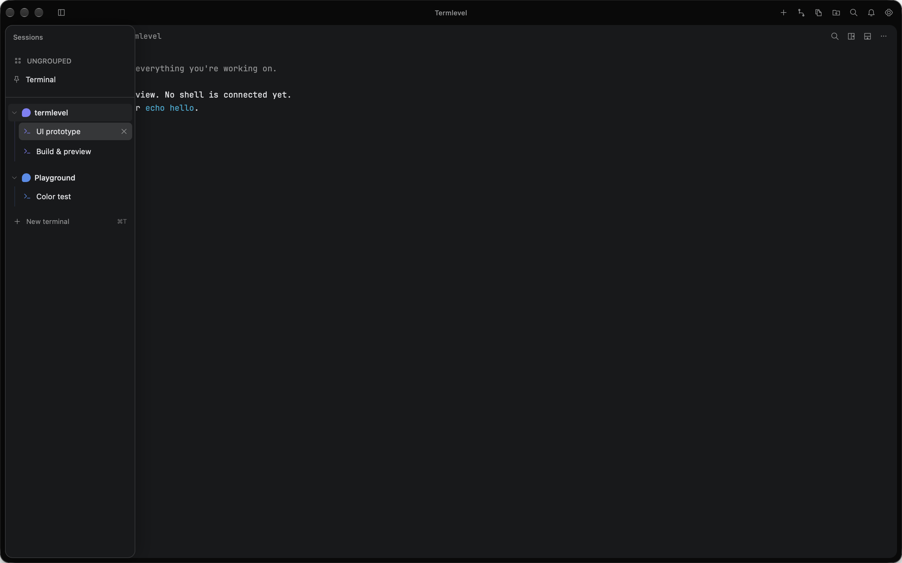

## Split panes and terminal status

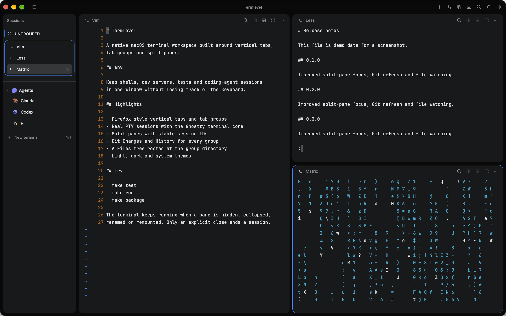

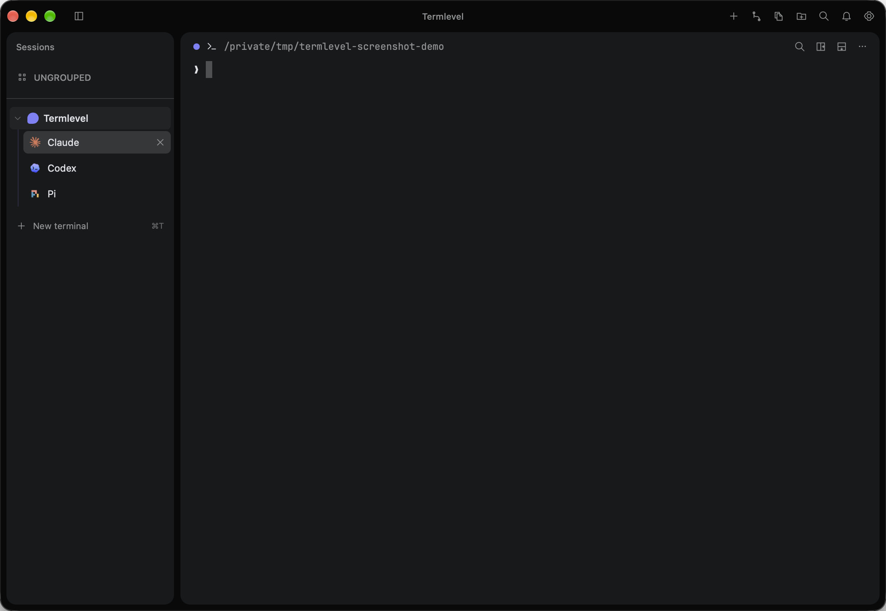

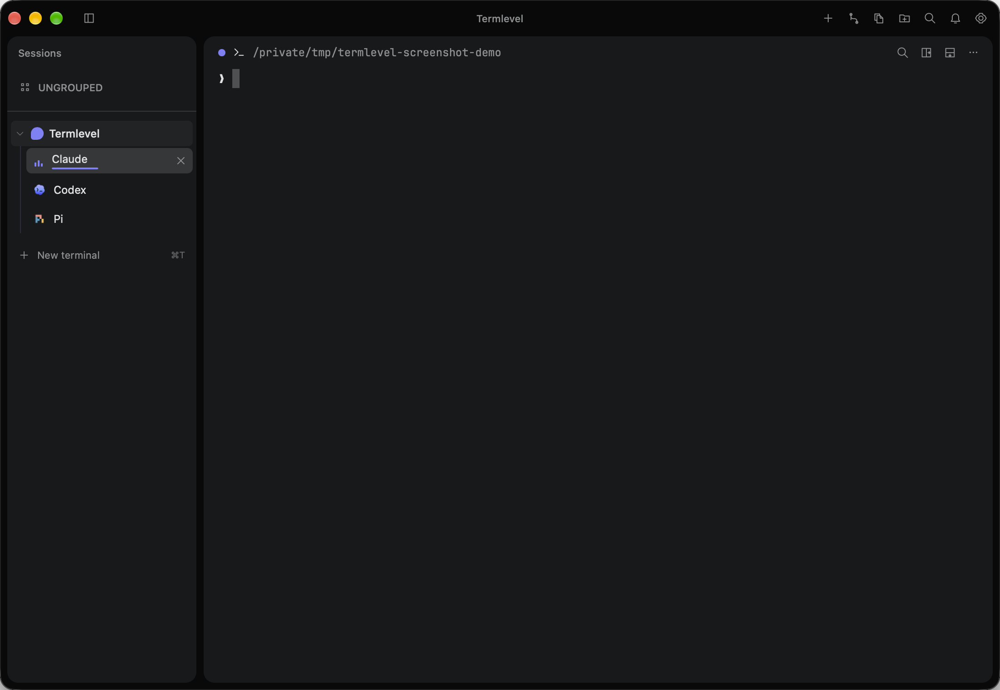

## Git and Files

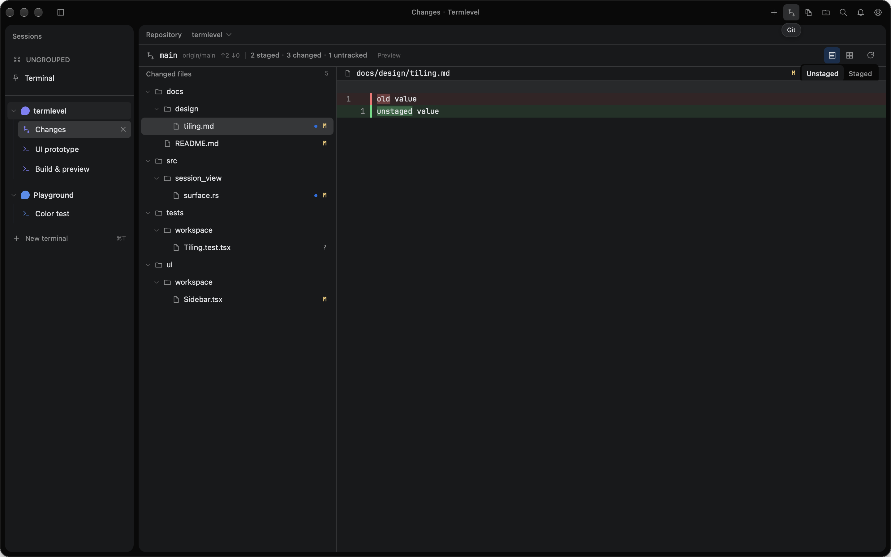

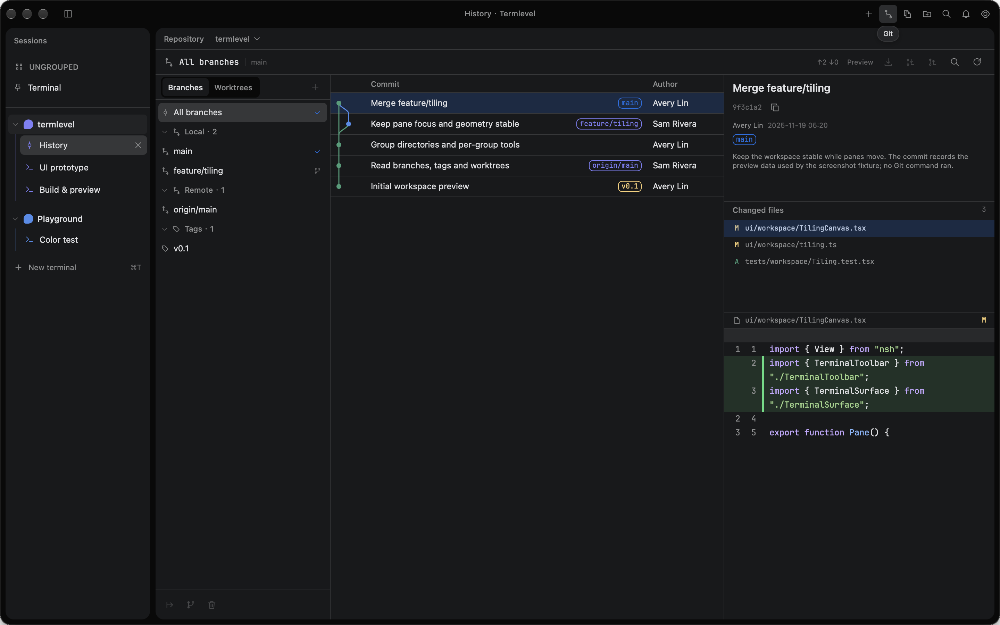

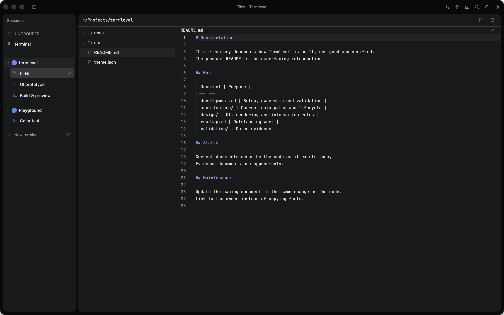

## Settings and themes

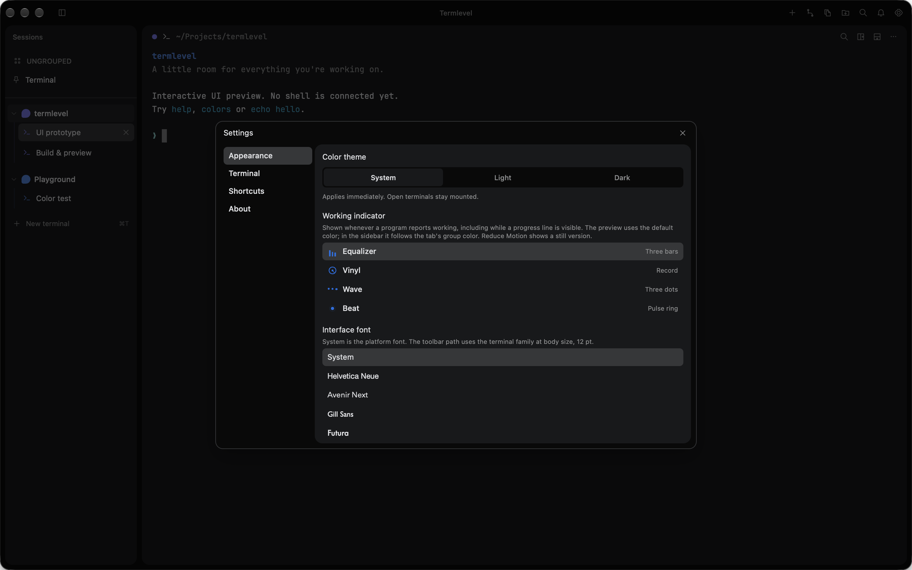

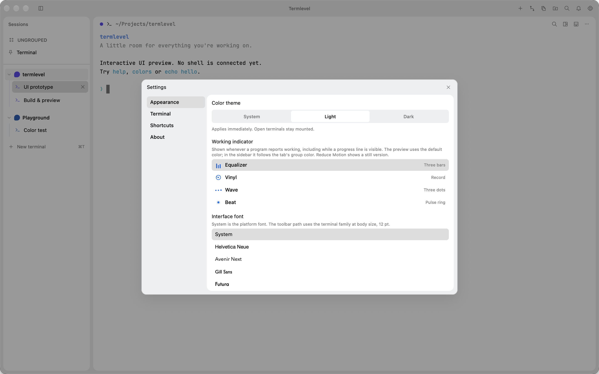

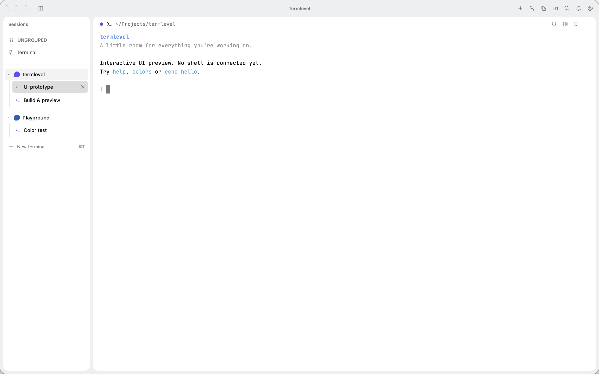

## Notifications

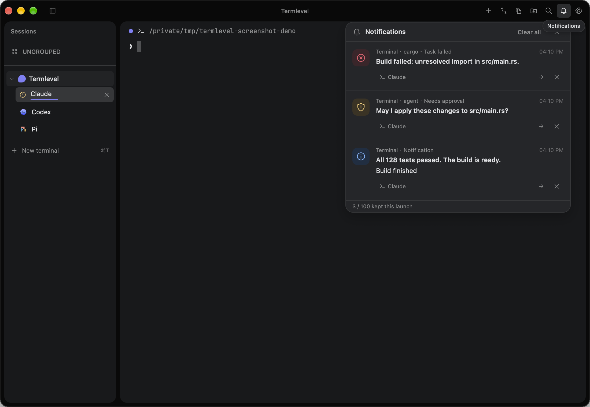
